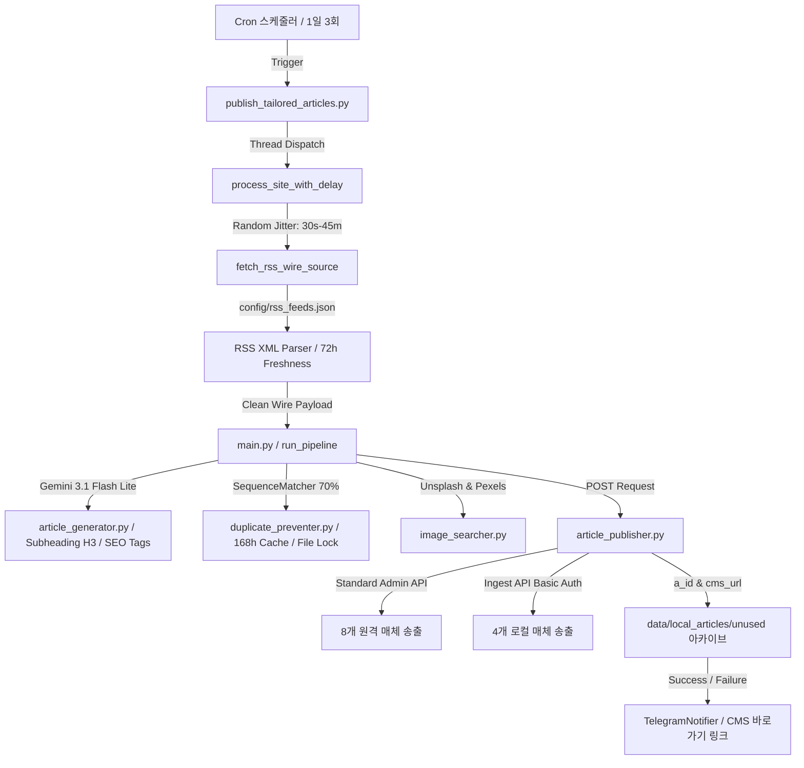

# System Blueprint: AI 기사 수집, 생성 및 자동 송출 시스템

본 문서는 실시간 고품질 뉴스 피드(RSS)를 수집하고, LLM(Gemini API)을 활용해 팩트 기반의 기사를 작성한 뒤, 저작권 프리 이미지를 매핑하여 원격 CMS(어드민 API 및 Ingest API)로 무작위 분산 송출을 처리하는 AI 기자 프로그램의 종합 설계도 및 개발 진행 상황을 명시합니다.

---

## 1. 시스템 아키텍처 개요 (Overview)

본 시스템은 매시간 주기적으로 작동하는 자동화 배치 프로그램으로, 다중 스레드 환경 하에서 기사의 팩트성 확보, 중복 발행(도배) 방지, 실시간 알림, 그리고 12개 미디어 채널에 대한 맞춤형(Tailored) 송출 정합성을 보장합니다.

---

## 2. 핵심 컴포넌트 상세 설계 (Core Components)

### 2.1 오케스트레이터 및 배치 제어
- **`publish_tailored_articles.py`**:
  - 시스템의 전체 구동을 제어하며, 12개 사이트를 **병렬 멀티스레드(Threading)** 구조로 분산 처리합니다.
  - **무작위 딜레이(Random Jitter)**: 각 스레드는 시작 시 `30초 ~ 45분` 사이의 랜덤 오프셋만큼 대기 후 기상을 시작하여 기계적인 발행 패턴을 원천 회피합니다.
  - **업무 시간 동기화 (EDT 09:00~18:00)**: 출근 시각(EDT 09:00 / UTC 13:00) 직후인 UTC 13:05~13:25 사이에 기상하여, 12개 매체를 약 30~45분 간격으로 순차 분산 송출하며 퇴근 시각(EDT 18:00 / UTC 22:00) 이전(EDT 16~17시경)에 100% 완료 보장.
  - **90/10 확률 분배**: 90% 확률로 해당 사이트 고유 테마의 뉴스를, 10% 확률로 일반(General) 뉴스를 채택하도록 분기 처리합니다.
- **`publish_medicaldaily_cron.py` (의약일보 독립 분산 배치)**:
  - 의약일보(medicaldaily.co.kr) 전용 1일 50개 분산 기사 생성 및 자동 송출 스케줄러입니다.
  - **KST 08:00~19:00 엄격 통제**: 한국 시간 기준 08시부터 19시 이전(08:00:00~18:59:59)에만 송출을 허용하며 시간 외 실행은 자동 스킵합니다.
  - **11시간 고른 분산**: 13분 주기 크론(`*/13 23,0-9 * * *` UTC = KST 08:00~18:59)으로 11시간에 걸쳐 매시간 4~5개씩 50개를 자연스럽게 분산 송출합니다.
- **`main.py`**:
  - `run_pipeline(source_file_path, target_sites)`을 구동하는 핵심 파이프라인 엔진입니다.
  - 기사 생성, 중복 차단, 이미지 매핑, 실송출, 아카이빙, 텔레그램 연동의 전체 트랜잭션을 조율합니다.
  - **`TelegramNotifier`**: 텔레그램 API를 활용하여 발행 성공/실패 알림을 전송하며, 본문 HTML이 4000자를 넘을 경우 태그가 깨지지 않게 **3800자 단위로 자동 분할(Part 1/2) 송출**합니다.

### 2.2 기사 팩트 수집 및 동기화 (RSS Feed Engine)
- **`sync_rss_feeds.py`**:
  - [categories.md](file:///home/stock_trading_bot/categories.md) 마크다운에 기재된 11대 카테고리별 83개 고품질 RSS 피드를 파싱합니다.
  - 기존 [config/rss_feeds.json](file:///home/stock_trading_bot/config/rss_feeds.json)의 데이터 유실 없이 **신규 피드를 추가(Append)하되 중복 주소는 자동 소거**하여 갱신합니다.
- **`publish_tailored_articles.py > fetch_rss_wire_source()`**:
  - RSS URL 목록을 무작위 셔플하고, 상위 7개 아이템 중 미사용 소스를 임의 선택합니다.
  - **최신성 필터(72시간)**: 발행 시간이 72시간을 초과한 오래된 뉴스는 수집 단계에서 배제합니다.
  - **중복 링크 배제(168시간)**: 최근 7일 내에 동일한 RSS 원천 링크가 기사 작성에 쓰였다면 수집 대상에서 영구 제외합니다.
- **`clicky_puller.py > fetch_clicky_matched_rss_source()` (의약일보 독자 관심 키워드 매칭)**:
  - Clicky Web Analytics의 최근 7일 인기 페이지 데이터를 분석하여 독자들의 관심도가 높은 1~3대 헬스케어 키워드(다이어트, 운동, 수명, 치매 등)를 도출합니다. (3단계 그레이스풀 폴백 체인 완비)
  - 도출된 관심 키워드와 주어진 27개 의약일보 RSS 피드 원문(제목 및 요약문) 간의 토큰 일치도(Relevance Score)를 계산하여 가장 연관성이 높은 신선한 뉴스를 팩트 소스로 매칭합니다.
  - 하루 50개 송출 중 1~3개 기사를 Clicky 관심 키워드 매칭 기사로 자동/수동 배정하여 기사의 흥미도와 대중성을 극대화합니다.

### 2.3 기사 본문 및 태그 생성 (AI Writer & Code-Level Optimization)
- **`article_generator.py`**:
  - **심층 취재기자(Investigative Journalist) 모드**: 단순 원문 재작성(Paraphrasing)을 배제하고, 공식 발표 기관 수치, 기준 시점, 원자료 맥락, 산업적 파급 효과를 심층 분석하여 서술합니다.
  - **본문 450단어 이상 보장 (소제목 제외)**: `max_tokens`를 2048로 확장하고, 파이썬 코드가 `<h3>` 소제목을 제외한 순수 본문 단어 수를 정밀 계측하여 풍부한 저널리즘 분량을 강제합니다.
  - **양괄식 첫 문단 + 기승전결 서사 구조**: 첫 문단은 소제목 없이 기사 전체를 관통하는 자연스러운 요약 리드로 시작하며, 이후 기(배경) → 승(데이터전개) → 전(파급효과) → 결(시사점)의 점진적 서사를 구축합니다.
  - **소제목 3~5개 `<h3>` 정규화**: 본문 내 비표준 헤딩(`<h2>`, `<h4>`, bold)을 파이썬 코드가 자동으로 `<h3>`로 정규화하고 3~5개 범위를 검증합니다.
  - **SEO 태그 20개 코드 자동 완성**: LLM의 부족분 발생 시 파이썬 코드가 본문 핵심 키워드로 중복 없이 20개를 자동 완성하여 불필요한 재시도 비용 낭비를 차단합니다.

### 2.4 대표 이미지 수집 및 멀티모달 시각 심사 (Image Cascade & Gatekeeper)
- **`image_searcher.py` (다단계 Cascade Waterfall)**:
  - **1순위 Wikimedia Commons**: 고화질 보도사진 및 자유 라이선스(CC, Public Domain) 위주 탐색. 구글 SEO 최적화 가로 1280px(`iiurlwidth=1280`) 렌더링으로 1MB 이하 안전 규격 유지.
  - **2순위 Unsplash & 3순위 Pexels**: 위키미디어 부재 시 안전망. 일반 가로형 이미지는 구글 디스커버 최적화 16:9 스마트 크롭(`&ar=16:9&fit=crop`)을 적용하고, **인물 및 세로/정사각(`aspect_ratio < 1.25`) 이미지는 원본 비율을 보존(`&fit=max`)**하여 얼굴/신체 잘림을 원천 방지합니다.
  - **종횡비(`aspect_ratio`) 메타데이터 전수 주입**: 모든 후보군(위키미디어, Unsplash, Pexels)에 정확한 종횡비 값을 계산하여 Gatekeeper에 인계합니다.
- **`image_gatekeeper.py` (Gemini 멀티모달 시각 검증)**:
  - 기사 제목/요약문과 후보 썸네일을 대조하여 동음이의어, 톤앤매너, 왜곡/오보, 워터마크를 심사합니다.
  - **일반 이미지 규격**: 사물/풍경/이벤트는 16:9 가로형(종횡비 1.25~2.4, 점수 7.0점 이상)을 원칙으로 채택합니다.
  - **핵심 인물 종횡비 예외조항 (0.50~2.50)**: 기사의 핵심 주인공(선수, 공인, 연예인, 연구자 등) 실제 사진의 경우, **세로형(3:4, 2:3), 정사각(1:1), 1:2 전신사진(aspect_ratio >= 0.50)** 등 다양한 비율을 전면 수용하며 적합도 8.0점 이상 시 최우선 합격으로 채택합니다.

### 2.5 중복 발행 차단 (Duplicate Preventer)
- **`duplicate_preventer.py`**:
  - 동시 다발적인 스레드 구동 환경에서 데이터 충돌(Race Condition)을 막기 위해 **파일 락(`fcntl`)** 기반의 안전한 동시성 입출력 구조를 구축했습니다.
  - **유사도 70% 차단**: 생성된 제목이 최근 168시간(7일) 이력의 제목들과 비교해 `difflib.SequenceMatcher` 기준 70% 이상 유사할 경우, 해당 제목을 Negative Constraint로 삼아 **최대 3회 즉시 재생성(Retry)**을 시도합니다.
  - **매체 간 3개 겹침 차단**: 최근 168시간 내에 전체 도메인을 통틀어 이미 2회 이상 사용된 RSS 원천 소스는 타 도메인에서 사용할 수 없도록 원천 차단하여 동일 뉴스가 매체 전체에 도배되는 것을 완벽히 예방합니다.
  - **카테고리 제약 필터**: 특정 카테고리가 2회 연속으로 발행되거나, 일일 발행 한도를 초과할 경우 해당 카테고리는 Gemini에 전달될 카테고리 후보군에서 제외시킵니다.
    * 일반 영문 매체: 일일 5개 상한, 카테고리당 최대 2개 상한 유지.
    * 의약일보(medicaldaily): 일일 50개 목표 송출 쿼터(`MEDICALDAILY_DAILY_LIMIT=50`) 지원을 위해, 카테고리당 일일 상한을 15개로 동적 확장하여 6개 카테고리 내에서 50개 이상 병목 없이 분산 송출 보장.
    * 의약일보 6대 분류 균등 분배 및 라이프 30% 가중치 스티어링: 당일 '라이프'(건강 상식, 건강 팁) 카테고리 비율이 30% 미만일 때 우선순위 가중치(`5.0`)를 부여하여 50개 중 최소 15개(30%)를 엄격 보장하고, 나머지 5개 카테고리는 당일 발행 수의 역가중치를 통해 6대 분류 전반이 균등하게 채워지도록 조율 (연속 2회 발행 차단 규칙은 100% 준수).

### 2.6 원격 어드민 및 Ingest API 송출 (Publisher)
- **`article_publisher.py`**:
  - **표준 어드민 API (`articles.php`)**: 8개 원격 미디어 사이트에 대해 multipart/form-data 인코딩을 거쳐 대표 이미지 바이너리와 함께 기사 초안(Draft)을 등록합니다.
  - **Article Ingest API (`/ingest/article`)**: 4개 로컬 작성 매체(`jobsnhire`, `mobilenapps`, `parentherald`, `booksnreview`)를 대상으로 HTTP Basic Auth 인증을 거쳐 기사를 Queued 상태로 자동 실송출합니다. (`franchiseherald`, `foodworldnews`는 송출 제외 처리)
  - **실시간 ID 룩업**: Ingest API 호출 전 `/ingest/reporters`, `/ingest/categories`, `/ingest/sources`를 실시간 조회하여 LLM이 선정한 카테고리와 가장 매칭률이 높은 정수형 카테고리 ID, 디폴트 기자 ID를 매핑해 냅니다.
  - **409 예외 흡수**: 이미 등록된 `external_id` (제목 해시 기반)의 기사를 재송출하려 시도할 경우, API 응답 사양에 명시된 `409 Conflict` 속에서 기존 `a_id` 및 `cms_url`을 추출해 정상 성공 처리로 마이그레이션합니다.
  - **Receive Article API (`/api/receive-article?paper=medi`)**: 제3분기 의약일보 전용 REST API로 `POST` 기사 송출 (`MEDICALDAILY_PUBLISH_MODE=publish` 설정에 따른 실시간 `publish`/`ar_status: 3` 정식 발행 및 `draft`/`ar_status: 0` 롤백 지원) 및 `GET ?remote_id=` 검증을 수행합니다.

### 2.7 하이퍼링크 100% 파이썬 주입 대원칙 (Link Injection Architecture)
- **`link_injector.py`**:
  - **대원칙 (No Prompt HTML)**: LLM 프롬프트에 `<a>` 작성을 일절 맡기지 않습니다. URL 환각, 따옴표 이스케이프 오류, HTML 깨짐을 원천 방지하기 위해 **모든 링크 주입은 100% 파이썬 코드 단에서 BeautifulSoup DOM 탐색 및 결정론적 가드레일**을 거쳐 수행합니다.
  - **외부 출처 링크 (100% Python Injection)**:
    * 수집된 실제 RSS 원문 URL(`source_url`)을 파이썬이 전달받아 본문 문단(`
`) 내의 구체적인 출처 명시 문구(예: `CoStar에 따르면`, `엔드포인츠뉴스 보도에 따르면`, `CBRE의 2025년 숙박업 데이터에 따르면`, `보건복지부의 2026년 만성질환 관리 디지털 전환 로드맵에 따르면`)를 탐색합니다.
    * 단순 단어('임상 시험', '데이터')가 아닌 **출처 문구 전체**에 정확히 1회의 외부 링크(`<a rel="nofollow" href="{source_url}" target="_blank" class="external_red">출처 문구 전체</a>`)를 파이썬이 직접 치환 주입합니다.
    * 한국어 출처 문구 길이 검증은 띄어쓰기 가변성을 감안하여 **다중 복합 가드레일 (`4 <= 글자수 <= 45` OR `1 <= 어절수 <= 10`)**을 적용하여 긴 기관/정책명도 누락 없이 100% 주입합니다.
  - **자사 내부 인라인 링크 (7대 결정론적 가드레일 & 2단계 하이브리드 엔진)**:
    1. **Fail-Safe (Zero-Link)**: 연관 기사가 없거나 인과/동향 관계가 부족하면 강제 주입하지 않고 원본 텍스트 100% 보존.
    2. **URL 무결성**: 파이썬이 보유한 실존 자사 기사 풀의 실존 URL만 매핑 (환각 원천 차단).
    3. **앵커 길이 통제**: 영문 3~6단어, 한국어 2~8어절(글자수 4~45자) 엄격 검증.
    4. **중첩 방지**: 이미 `<a>` 링크가 있거나 헤딩(`h1~h6`), 상단 요약박스, 인용구 내부 치환 금지.
    5. **1회 제한**: 본문 전체에서 최초 1회만 치환하여 과도한 링크 도배 방지.
    6. **주제 연관성(Semantic Relevance) 및 억지 대조 차단**: 대상 기사 제목과 현재 기사 핵심 주제 간 의미 있는 명사 교집합이 없거나, `대조적으로`, `이와 달리`, `반면에` 등 억지 대조 수식어가 수반된 경우 즉시 기각. 단, **[동향·경향·유사 사례·배경] 4대 인용 프레임**(`동향|경향|흐름|추세|사례|예시|일환|마찬가지|비슷|유사|앞서|지난|보고된|논의된|지적된|관련`)은 적극 수용.
    7. **2단계 파이썬 자동 Fallback 주입 (하이브리드 세이프티넷)**: LLM이 contextual link를 누락하거나 매칭 탈락한 경우, 자사 최신 기사 풀의 2어절 이상 핵심 복합명사구를 본문에서 찾아 안전하게 1회 인라인 링크 확정 주입.
  - **연관기사 카드 박스 (`blockquote.readmore-box`)**:
    * 일반 매체: 본문 하단에 `[Read More: Recommended Stories]` 카드 박스 주입.
    * 의약일보: 본문 하단에 `[의약일보 기사 더보기]` 카드 박스로 자동 분기 주입.

### 2.8 제3분기 의약일보(medicaldaily.co.kr) 한국어 특화 파이프라인
- **언어 및 문체**: 100% 한국어 전문 보도 문체(`~했다`, `~밝혔다`, `~전망이다`), 기승전결 3~5개 `<h3>` 소제목, 한국어 SEO 태그 20개.
- **본문 상단 [핵심 요약] 박스**:
  * Q&A(자주 묻는 질문) 섹션을 전면 배제하고, 본문 최상단에 임팩트 있는 3개 핵심 불릿을 담은 `div.md-summary-box`(`border: 1px solid #c7d2fe; background-color: #ffffff; padding: 16px 20px;`)를 자동 주입.
- **이미지 수집 4단계 Waterfall 및 종횡비·크기 규격 ([요건 6-7])**:
  * **0순위**: 의약일보 DB 자체 검색 (`_search_medicaldaily_images`)
  * **1순위**: Pexels
  * **2순위**: Wikimedia Commons
  * **3순위**: Unsplash
  * **종횡비 3단계 계층적 우선순위 ([요건 6])**:
    - **Tier 1 (가로형 우선)**: `aspect_ratio >= 1.25` (4:3 또는 16:9 와이드) 최우선 심사 및 채택.
    - **Tier 2 (1:1 차선)**: `0.90 <= aspect_ratio <= 1.10` (정사각). Tier 1 부재 시 차선 심사.
    - **Tier 3 (세로형 최후선)**: `aspect_ratio < 0.90` (3:4, 2:3). Tier 1, 2 모두 부재 시에만 최후선 심사.
  * **이미지 크기 가로 1000px 이하 한정 ([요건 7])**:
    - 의약일보 DB: `?width=1000`
    - Wikimedia: `iiurlwidth=1000`
    - Unsplash: `w=1000`
    - Pexels: `large` (~940~1000px) 우선
    - 비상 Fallback: `w=1000`
    - 타 12개 영문 매체는 기존 1280px~1880px(구글 Discover 대응) 100% 불변 유지 (Blast Radius 0%).
- **기자명 및 카테고리 매핑**:
  * 기자명: `"고진아"`, `"장선희"`, `"정휘"` 3인 순환/지정 매핑.
  * 카테고리: 의약일보 6대 분류(`정책`, `경영`, `학술`, `병원·제약`, `라이프`, `오피니언`).

---

## 3. 실행 및 아카이브 데이터 흐름 (Data Management)

- **원격 송출 완료 기사**:
  - `data/generated_articles/` 에 `domain_article_id.json` 형태로 캐싱 적재됩니다.
  - **10일 자동 청소**: 생성된 지 10일(240시간)이 지난 캐시 파일은 디스크 용량 관리를 위해 메인 프로세스 종료 시 자동 삭제됩니다.
- **로컬 송출 완료 기사**:
  - `data/local_articles/unused/` 에 `domain_a_id.json` 형태로 물리 격리 저장됩니다.
  - 동영상이나 미디어 리소스의 수동 관리를 위해 사용자가 `mark_article_used.py` CLI 도구를 사용해 해당 기사를 `used/` 폴더로 손쉽게 이동 및 관리 마킹할 수 있게 설계되었습니다.
- **실시간 로깅**:
  - `logs/{domain}.log` 경로로 각 스레드별 작업 상황이 완전 격리 저장되어 디버깅과 추적성을 대폭 향상했습니다.

---

## 4. 진행 현황 요약 (Progress Log)

1. **폴더 구조 및 파일 정리**: 외부 API 호출부 분할 및 환경 정보 `.env` 안전 격리 완료.
2. **카테고리 캐싱 연동**: 8개 사이트의 카테고리 130종 동기화 자동화 구축.
3. **대표 이미지 멀티파트 업로드**: 이미지 바이너리 폼 데이터 업로드 및 PHP 백엔드 작은따옴표 백슬래시 오류 우회 완료.
4. **텔레그램 알림 구현**: 간소화된 텔레그램 기사 송출 성공/실패 레이아웃 추가.
5. **무작위 시각 송출 분산**: 멀티스레드 기상 및 랜덤 오프셋 대기 도입.
6. **7일 중복 차단 및 중복 소스 필터**: SequenceMatcher 70% 검증, 최근 168시간 사용 RSS 링크 배제 셔플러 탑재.
7. **RSS 최신성 필터**: 72시간 이내 발행 뉴스 강제화 및 오래된 소스 스킵 완료.
8. **로컬 매체 격리 폴더 관리**: jobsnhire 및 5종 매체 격리 보관 폴더 분리 및 CLI 도구(`mark_article_used.py`) 구현.
9. **소제목 태그 통일 및 SEO 태그 20개**: `<h3>` 태그 강제 및 기사별 20개 맞춤형 태그 메타 데이터 탑재 완료.
10. **동시성 덮어쓰기 유실 방지**: File Lock 도입을 통해 동시 다발성 스레드 레이스 컨디션 해결.
11. **categories.md 피드 병합**: 11대 카테고리 83개 고품질 RSS 피드를 기존 설정에 중복 없이 추가 병합 완료.
12. **Article Ingest API 이식 완료**: 로컬 전용 6개 사이트의 API 실전 이식, 409 Conflict 처리 및 실전 모의 등록 검증 완료. (a_id 획득 및 텔레그램 연계 완료)
